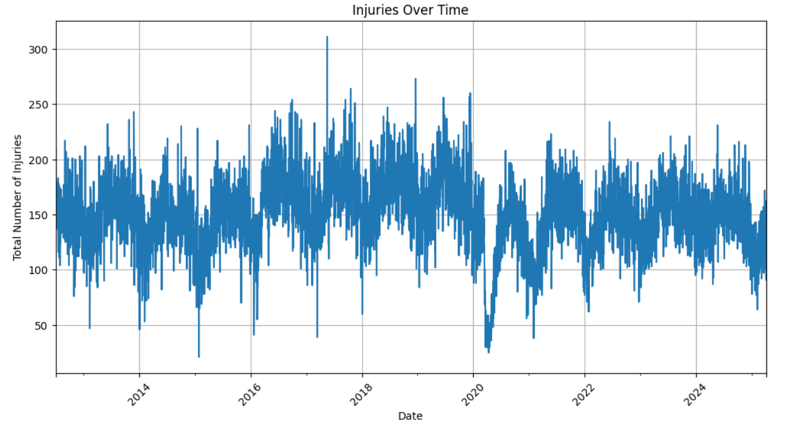
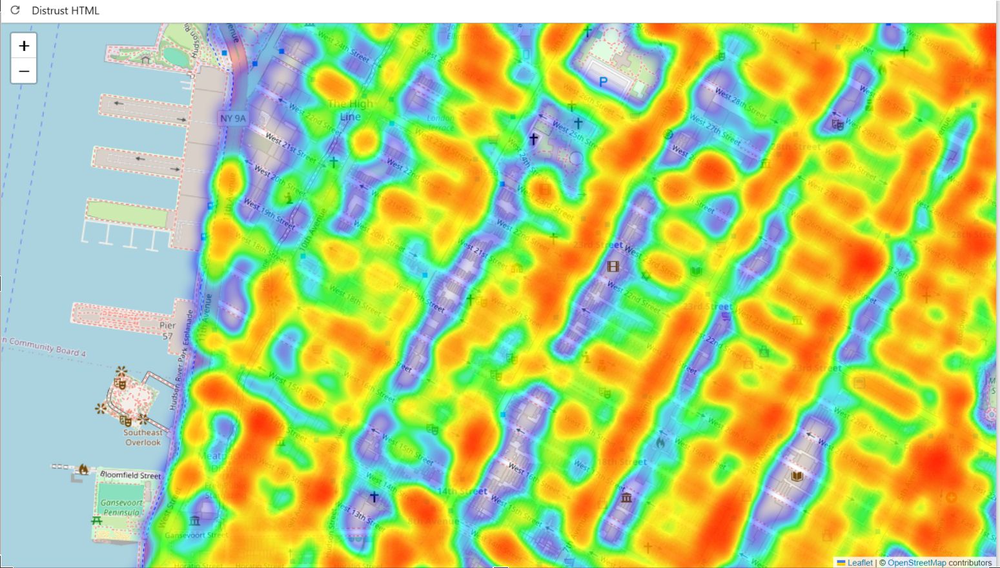

# 🚗 NYC Motor Vehicle Collision Injury Prediction
A machine learning project that predicts injury risk from New York City motor vehicle collisions using historical crash data.
📌 Project Overview

New York City continues to experience motor vehicle collisions that result in injuries and fatalities. This project uses machine learning and data visualization to analyze historical collision records and predict whether a crash scenario may result in an injury.

The goal is to help traffic safety officials and city planners make data-driven decisions, identify collision patterns, and support the city's Vision Zero initiative.

🎯 Project Objectives
Predict the likelihood of injury in a motor vehicle collision.
Identify high-risk crash patterns by location and time.
Analyze vehicle types and contributing crash factors.
Visualize collision trends using charts and interactive heatmaps.
Support proactive traffic safety planning and resource allocation.
✨ Features
🤖 Injury Prediction: Predicts whether a collision scenario is associated with an injury using a Random Forest Classifier.
🗺️ Interactive Heatmap: Visualizes collision locations throughout New York City.
📈 Injury Trends: Displays injury patterns over time.
🕒 Hourly Analysis: Shows collision frequency by hour of the day.
📊 Model Evaluation: Reports accuracy, precision, recall, and F1-score.
💻 Interactive Application: Allows users to train the model, enter crash details, and generate predictions.
📂 Dataset

Source: NYC Open Data — Motor Vehicle Collisions

The dataset contains historical collision records, including:

Crash date and time
Borough and location
Vehicle types
Contributing factors
Number of people injured
Number of people killed
Data Preprocessing

The data preparation process includes:

Cleaning missing and incomplete values.
Selecting relevant features.
Extracting the crash hour and day of the week.
Encoding categorical variables into numerical values.
Creating a binary injury indicator.
Splitting the dataset into training and testing sets.
🧠 Machine Learning Model
Algorithm: Random Forest Classifier

The project uses a Random Forest Classifier, a supervised learning algorithm that combines multiple decision trees to generate predictions.

Why Random Forest?

Handles complex relationships between features.
Supports class weighting to address class imbalance.
Provides feature importance scores.
Offers a practical balance between performance and interpretability.
Model Workflow
NYC Collision Dataset
         |
         v
   Data Cleaning
         |
         v
 Feature Engineering
         |
         v
  Train/Test Split
         |
         v
 Random Forest Model
         |
         v
 Model Evaluation
         |
         v
 Injury Prediction

Example Prediction
Feature	Example
Borough	Brooklyn
Vehicle Type	Sedan
Contributing Factor	Unsafe Speed
Crash Hour	14 (2 PM)
Day of Week	Wednesday
[!NOTE]
The numerical category codes used by the application must match the encoding established during model training. Predictions are estimates based on historical data and are not guarantees of actual crash outcomes.
📊 Visualizations

The application includes three primary visualizations.

1. Injuries Over Time

Shows injury trends across the available dataset period.

2. Crashes by Hour of the Day

Highlights how collision frequency changes throughout the day.

3. Interactive Crash Heatmap

Displays the geographic distribution of reported collisions across New York City.








🛠️ Technologies Used
Technology	Purpose
Python	Core programming language
pandas	Data cleaning and manipulation
scikit-learn	Machine learning
Matplotlib	Data visualization
Seaborn	Statistical visualization
Folium	Interactive maps
Jupyter Notebook	Application environment
⚙️ Installation and Setup
Prerequisites
Python 3.7 or higher
Jupyter Notebook
NYC Motor Vehicle Collisions dataset
Step 1: Clone the Repository
git clone [https://github.com/YOUR-USERNAME/nycAccidentsHotmap.git](https://github.com/moeshalati/nycAccidentsHotmap)
cd nycAccidentsHotmap

Step 2: Install Dependencies
```
pip install notebook pandas folium scikit-learn matplotlib seaborn
```

Step 3: Download the Dataset

Download the dataset from NYC Open Data.

Save the CSV file to a location accessible from your computer.

Step 4: Launch Jupyter Notebook
jupyter notebook


Open crash_analysis.ipynb in your browser.

📈 Model Evaluation

The dataset is divided into training and testing subsets.

80% Training Data: Used to train the model.
20% Testing Data: Used to evaluate predictions on unseen records.
Evaluation Metrics
Metric	Description
Accuracy	Percentage of correct predictions
Precision	How many predicted injury cases were actual injury cases
Recall	How many actual injury cases were correctly identified
F1-score	Balance between precision and recall

[!WARNING]
Initial evaluation indicated moderate accuracy and relatively low precision and recall. This suggests that the model may have difficulty identifying injury cases reliably. Actual metric values should be added after confirming the evaluation output.
Potential Improvements
Tune model hyperparameters.
Improve class imbalance handling.
Evaluate additional features.
Compare alternative classification algorithms.
Validate performance against more recent collision records.


🔒 Ethics and Privacy
Uses publicly available NYC collision data.
Avoids treating predictions as definitive outcomes.
Recognizes potential data quality and geographic reporting biases.
Requires further validation before operational use in enforcement or emergency resource allocation.
[!IMPORTANT]
This application is a decision-support prototype. Its predictions should not replace professional judgment or established traffic safety procedures.
🔮 Future Improvements
Develop a web-based user interface.
Tune model parameters and compare alternative algorithms.
Incorporate weather and additional road-condition data.
Automate dataset updates and model retraining.
Improve prediction performance for injury cases.
Expand geographic and temporal risk analysis.

🙏 Acknowledgments
NYC Open Data
NYC Vision Zero
The open-source Python community

Built with Python, machine learning, and a commitment to safer streets in New York City.
